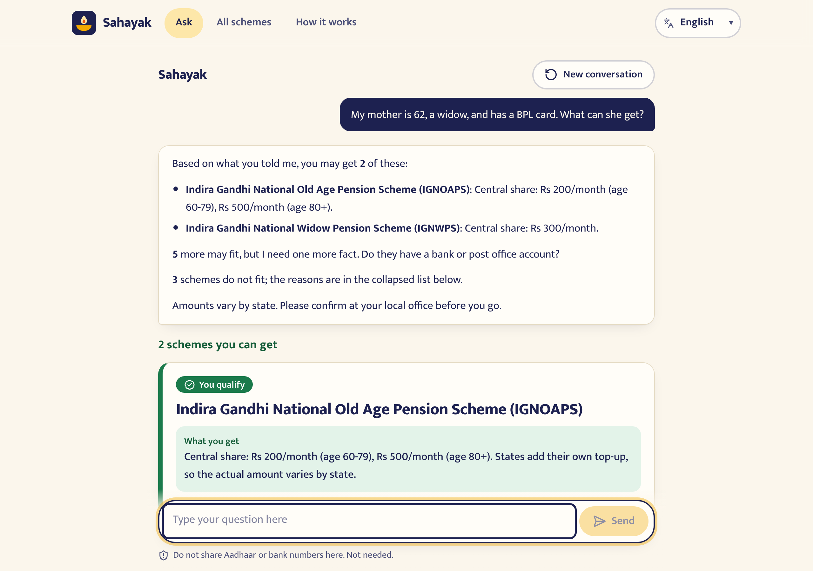
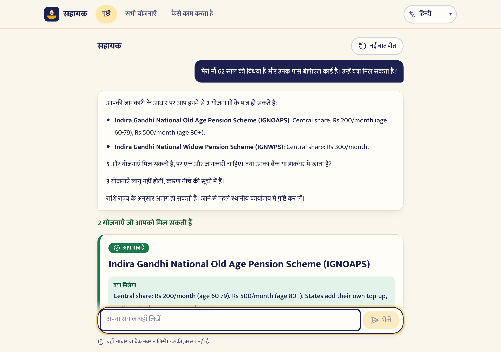
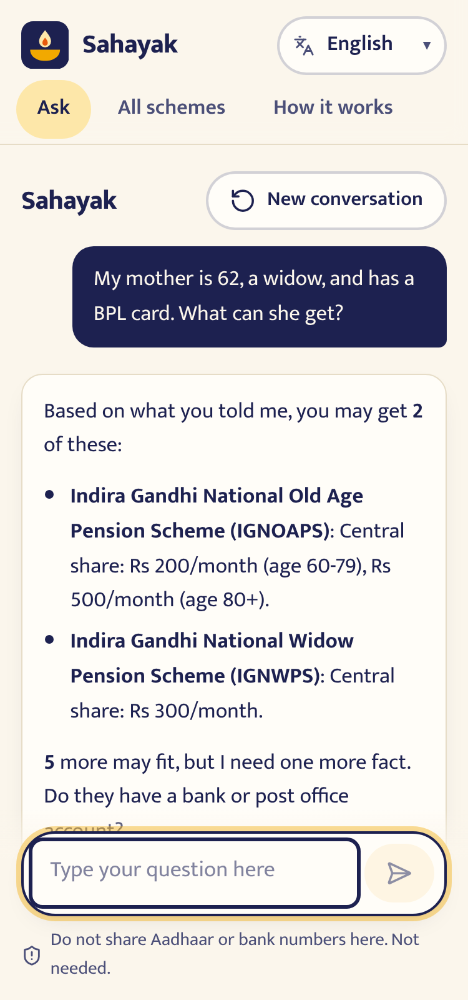
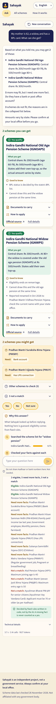
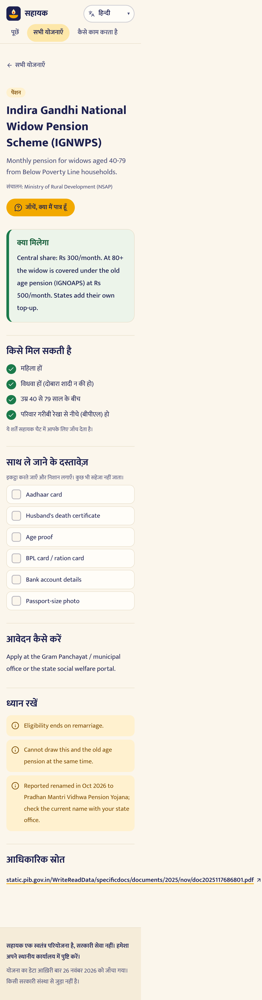
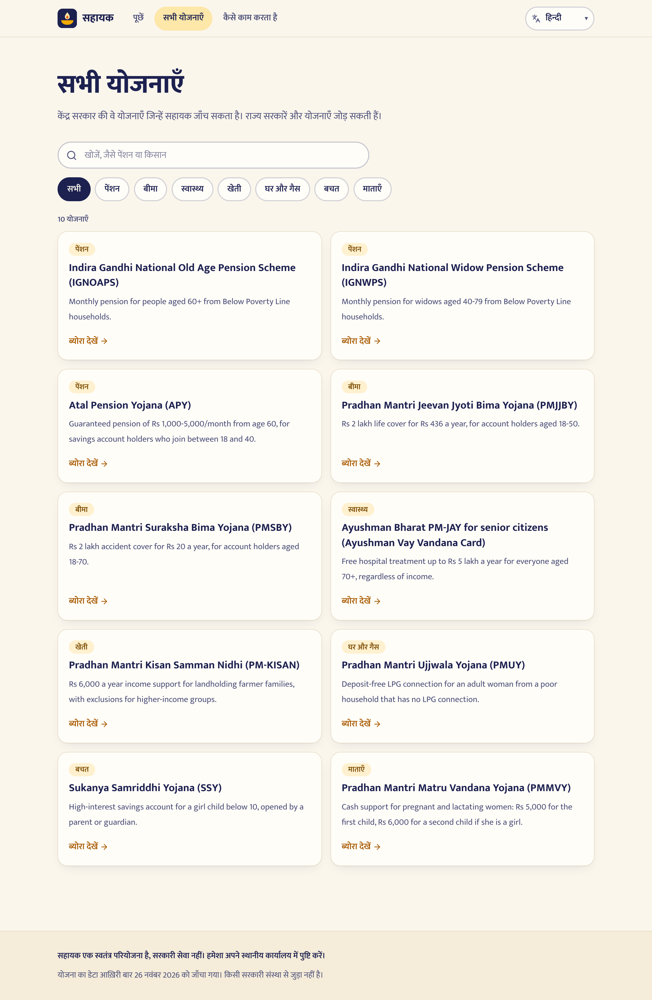
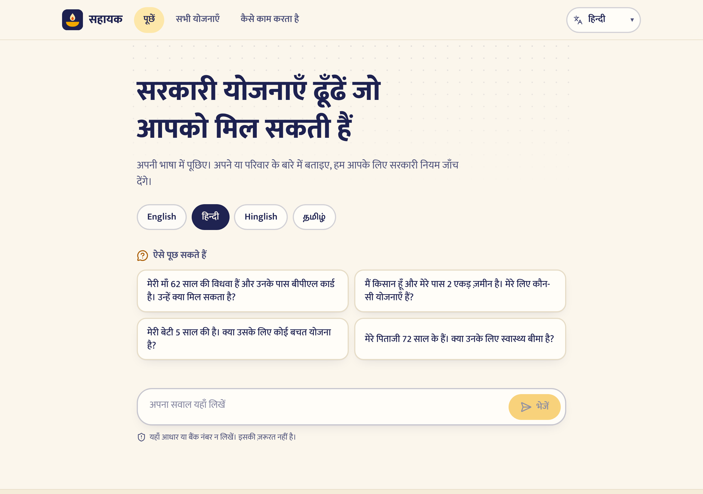
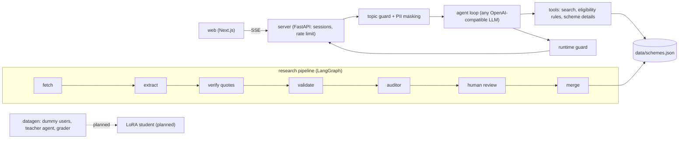

<div align="center">

# Sahayak

**Multilingual AI agent for Indian government schemes**

सहायक

**A chat agent that tells people which government schemes they qualify for, in Hindi, Tamil, Hinglish or English, with eligibility decided by tested Python rules instead of the LLM.**

[](https://github.com/ice-user/sahayak/actions/workflows/ci.yml)


**[▶ Live demo](https://web-one-theta-z4hq0kdc3d.vercel.app)** (free tier: the first reply after idle can take ~50 s) · [Architecture](#architecture) · [Results](#-results) · [Quick start](#quick-start-with-your-nvidia-key-windows-powershell) · [API docs](docs/API.md) · [Research agent](research/README.md)

<p align="center">
  
  
</p>

</div>

<details>
<summary><b>More screenshots</b></summary>
<br>

| Mobile chat | "Why this answer?" trace | Scheme detail |
|:---:|:---:|:---:|
|  |  |  |

| Schemes list | Hindi home |
|:---:|:---:|
|  |  |

</details>

## Contents

- [Highlights](#-highlights) · [Approach and what's novel](#-approach-and-whats-novel) · [Metrics we track](#-metrics-we-track)
- [Results](#-results) · [Limitations and roadmap](#-limitations-and-roadmap)
- [How a question flows](#how-a-question-flows) · [Why eligibility is decided in code](#why-eligibility-is-decided-in-code)
- [Architecture](#architecture) · [Tech stack](#tech-stack)
- [Run the full app locally](#run-the-full-app-locally) · [Deploy](#deploy) · [Grow the scheme database](#grow-the-scheme-database-research-agent)
- [Quick start (NVIDIA)](#quick-start-with-your-nvidia-key-windows-powershell) · [Other providers](#quick-start-with-other-providers-windows-powershell)
- [Layout](#layout) · [Latency](#latency) · [Staying on topic](#staying-on-topic) · [Evals](#evals) · [MCP server](#mcp-server)
- [Schemes covered](#schemes-covered-central-share-only) · [Distillation data](#distillation-data-for-the-planned-lora-student-model)

## ✨ Highlights

- **The LLM never decides eligibility.** A deterministic three-verdict rule engine (`eligible` / `not_eligible` / `need_info`) does; a runtime guard blocks any answer that offers a scheme the engine did not confirm. Evidence: 0 false eligibility claims in the agent eval; an empty profile is tested to never be `eligible`.
- **Multilingual hybrid retrieval.** Multilingual embeddings fused with BM25 (Reciprocal Rank Fusion). Evidence: on non-English queries, dense hit@1 is 0.88 vs 0.12 for BM25 alone.
- **Research pipeline with an auditor and a human.** A LangGraph pipeline extracts scheme records with a verbatim quote per rule, an independent auditor agent looks for misreadings, and nothing is merged without human approval.
- **PII masking.** Aadhaar, PAN and phone numbers are masked before a message reaches the LLM provider.
- **From "you qualify" to "here is what to do".** `sahayak/planner.py` + `/api/plan` turn several schemes into one plan: a merged document checklist ("any one of" groups collapsed), online vs in-person routes with the easier one recommended, office visits grouped into as few trips as possible, and personalised "be careful" warnings. Every step, document and warning carries a verbatim quote from the official page, checked by code (`research/application_check.py`).
- **Safe with vulnerable users.** `sahayak/vulnerability.py` spots hardship (homeless, elderly alone, abuse, self-harm) in four languages. The reply acknowledges it, asks at most two questions (ranked in code by how many schemes each fact unlocks), skips irrelevant ones, and adds verified helplines (`data/help_resources.json`, each checked against an official gov.in page). A self-harm message gets a fixed reply that leads with Tele-MANAS 14416 and 112.
- **Stays on topic.** A rules layer plus an LLM classifier redirect off-topic and jailbreak messages; the rules fallback alone is measured on 205 cases (below).
- **Production plumbing.** SSE streaming, an MCP server exposing the same tools, rate limiting, CI on every push, Docker + Render for the API, Vercel for the web app.

## 🧠 Approach and what's novel

- **LLM as fact-collector, code as decider.** The model only extracts facts and explains results; `sahayak/rules.py` returns one of three verdicts (`eligible`, `not_eligible`, `need_info`), and a missing fact is never treated as true or false.
- **Runtime guard.** `sahayak/guard.py` checks every final answer against the rule verdicts and blocks any scheme offered as available that the engine did not confirm: one corrective retry, then a safe fallback listing only verified schemes.
- **Quote-grounded extraction.** In the research pipeline every rule carries a verbatim quote from the official source and numbers are compared exactly (`research/verifier.py`); an independent auditor agent hunts for misreadings and a human approves before anything is merged.
- **PII masking before the provider.** `sahayak/privacy.py` masks Aadhaar, PAN and phone numbers before a message reaches the LLM.
- **Multilingual hybrid retrieval.** `sahayak/hybrid.py` fuses multilingual embeddings with BM25 using Reciprocal Rank Fusion, falling back to BM25 alone.

## 📏 Metrics we track

| Metric | Definition | Where measured |
|---|---|---|
| `used_tool` (tool use) | the agent called the expected tool (usually `check_eligibility`) | `evals/run_agent_evals.py` |
| `recall` | share of expected-eligible schemes the answer mentions | `evals/run_agent_evals.py` |
| `no_false_claim` | none of the case's `expect_not_claimed` schemes is named as available | `evals/run_agent_evals.py` |
| `asked_followup` | for vague questions, the answer asks a question | `evals/run_agent_evals.py` |
| `pass_rate` | share of non-error cases where every quality check present passed (`recall` must be 1.0) | `evals/run_agent_evals.py` |
| p50 / p90 latency | per-answer latency percentiles, errors excluded | `evals/bench_latency.py` |
| TTFT | p50 time to first streamed token | `evals/bench_latency.py` |
| LLM calls / tokens per turn | mean LLM round trips and tokens per turn | `evals/bench_latency.py` |
| hit@1 / hit@3 / MRR | correct scheme ranked first / in the top 3 / mean reciprocal rank, overall and for non-English queries | `evals/run_retrieval_eval.py` |
| on-topic FP rate | on-topic messages that were not answered (redirected or given a canned greeting); target <= 2% | `evals/run_topic_eval.py` |
| off-topic recall | off-topic messages that were redirected | `evals/run_topic_eval.py` |
| jailbreak recall | jailbreak messages that were redirected | `evals/run_topic_eval.py` |
| judge faithfulness / language / completeness | LLM-as-judge scores, 1-5 each, after deterministic checks (unsupported rupee amounts, script match) that can cap them | `evals/judge.py` (run with `run_agent_evals.py --judge`) |

### Research experiment: distilling the 120B extractor into a small LoRA model

**Question:** can a small open model, fine-tuned on a big model's labels, turn scheme eligibility text into rules as well as the big model, cheaply and offline?

**Setup**
- **Data:**
  - Scraped **5,137** myscheme.gov.in schemes (`scripts/collect_myscheme.py`) and rendered 736 of them.
  - Split their eligibility sections into **5,163 bullets** (`research/bullets.py`).
  - Labelled every bullet with **Nemotron 120B** (`scripts/build_finetune.py`) and kept the 93.6% of labels that pass the deterministic checker (`research/bullet_check.py`).
  - The train/val/test split is **by scheme** (3,731 / 433 / 518), so no test scheme is seen in training.
- **Gold test set:**
  - Every test label was re-reviewed (`data/finetune/GOLD.md`). The teacher's labels needed fixing in 8.9% of bullets, mostly made-up state rules and missed conditions.
  - The review was LLM-assisted, with a 30-item human spot-check sample.
- **Training:** LoRA (r=16) on **Qwen3-0.6B** and **Qwen3-1.7B**, 2 epochs, on Kaggle's free 2×T4, with both models trained in parallel (`kaggle/`, `scripts/finetune_qwen.py`).
- **Serving:** the LoRA was merged into the base model, quantised to 8-bit (q8_0) and run in **Ollama on a laptop CPU** (Intel Core Ultra 5, no NVIDIA GPU).

**Results** on 60 gold test bullets (same sample for every model; `scripts/eval_extractors.py`):

| Model | Size | Rule F1 | Exact match | Safety errors¹ | Made-up rules | p50 latency / bullet | Cost |
|---|---|---|---|---|---|---|---|
| Nemotron (teacher, API) | 120B | 74.1% | 88.3% | 0 | 6 | 0.65 s | API tokens (1,315 / bullet) |
| qwen3:4b, few-shot, no fine-tune | 4B | 20.3% | 35.0% | 2 | 40 | 8.5 s | free |
| Qwen3-0.6B, no fine-tune | 0.6B | 4.3% | 5.0% | 6 | 118 | 21.7 s | free |
| **Qwen3-0.6B + LoRA**, q8 (Ollama) | 0.6B | 69.2% | 86.7% | **0** | 6 | **3.25 s** | free |
| **Qwen3-1.7B + LoRA**, q8 (Ollama) | 1.7B | **76.9%** | **90.0%** | **0** | **5** | 4.3 s | free |

¹ A rule on the right field with the wrong bound or value, e.g. a wrong age or income limit.

**Findings**
- **Fine-tuning matters more than size.** LoRA took Qwen3-0.6B from 4% to 69% F1 and from 118 made-up rules to 6. The fine-tuned 0.6B beats an untrained model about 7× its size.
- **The 1.7B student matched the 120B teacher** at 1/70th of the size (F1 76.9 vs 74.1, exact match 90.0 vs 88.3) with zero safety errors. Treat this as "on par" rather than "better": n=60, and the gold labels started from the teacher's own labels, which favours the teacher.
- **8-bit quantisation cost no accuracy and made inference about 3× faster** (10.2 s → 3.25 s per bullet for the 0.6B). 4-bit was barely faster and lost accuracy (1.7B: −10 F1), so q8 is the sweet spot.
- **Throughput:** 4 parallel requests raise the 0.6B on CPU from 18.5 to **62 bullets/min**, with 58 of 60 outputs identical. At that rate the whole 5,163-bullet corpus converts in about 1.5 h, offline and free.
- **Limitations:** a small, LLM-assisted gold set; the training labels are silver (teacher plus code checks); the student is evaluated per bullet, not end to end through the agent.

## 📊 Results

| Area | Result |
|---|---|
| Tests | 925 passing (pytest), plus web vitest; CI on every push |
| Agent eval (NVIDIA Nemotron, 10 cases, 2026-11-27) | tool use 100%, recall 100%, no false eligibility claims 100%; p50 latency 3.8 s, p50 time-to-first-token 1.3 s, about 2.2 LLM calls per turn. Latency was cut from about 53 s by reducing round trips |
| Retrieval (20 queries) | hybrid hit@1 0.90, MRR 0.94; non-English hit@1: dense 0.88 vs BM25 0.12 |
| Topic guard, classifier down (rules fallback, 205 cases) | 0 on-topic false positives, off-topic recall 59/60, jailbreak recall 16/16 |
| Eval suite | 46 agent cases (en 22 / hi 10 / ta 7 / Hinglish 7) checked offline against the rule engine, plus an LLM-as-judge (faithfulness / language / completeness) that runs weekly in CI |

> **Honest note:** the judge and the 46-case set have not had a live run yet; the agent numbers above are from the earlier 10-case run.

## 🚧 Limitations and roadmap

- The database covers 10 central schemes; it is meant to grow through the research pipeline (state schemes are not modelled yet).
- The **extractor** student is built (see Research experiment). Distilling the **chat agent** itself into a small model is still planned: the teacher-data pipeline exists, but no agent model has been trained.
- Follow-up questions currently come partly from a fallback path rather than always from the model.
- Free-tier hosting has cold starts: the first request after idle time is slow.

The full detail is below.

## How a question flows

Ask in Hindi, Tamil, Hinglish or English, for example *"My mother is 62, a widow, BPL card holder. What can she get?"*, and Sahayak:

1. masks Aadhaar, PAN and phone numbers, and the topic guard redirects anything that is not about schemes
2. pulls the facts out of the question and asks follow-up questions when something is missing
3. searches a scheme database
4. **decides eligibility in plain Python rules, never with the LLM**
5. the runtime guard checks the final answer and blocks any scheme the rule engine did not confirm
6. replies in the user's language with benefits, documents, how to apply and the official source

## Why eligibility is decided in code

If an LLM wrongly tells a widow she qualifies for a pension, she may lose a day's wages queueing at an office for nothing. So the model only *collects facts*. A deterministic engine (`sahayak/rules.py`) returns one of three verdicts:

| Verdict | Meaning | What the agent does |
|---|---|---|
| `eligible` | every rule passed | explains benefits, caveats, documents, source |
| `not_eligible` | a rule failed | says which rule and why |
| `need_info` | nothing failed, but facts are missing | asks the user for exactly those facts |

A missing fact is never treated as true or false. The test suite checks that an empty profile is never `eligible`.

Two more safety layers sit on top: a **runtime guard** (`sahayak/guard.py`) checks every final answer and blocks any scheme offered as available that the rule engine didn't confirm (one corrective retry, then a safe fallback listing only verified schemes), and strips links that aren't official sources. **Aadhaar, PAN and phone numbers are masked** (`sahayak/privacy.py`) before a message ever reaches the LLM provider.

## Architecture



<details>
<summary>Text version of the diagram</summary>

```
 web/ (Next.js)  ──SSE──▶  server/ (FastAPI)  ──▶  sahayak/ agent loop ──tools──▶ search · eligibility rules · scheme details
   chat, scheme cards,        sessions, rate limit,       any OpenAI-compatible LLM            data/schemes.json
   quick replies, "why"       streaming events            (NVIDIA, Gemini, Groq, Ollama)            ▲
                                                                                                    │ human-approved merges
 research/ (LangGraph): official page/PDF ─▶ extract ─▶ verify quotes ─▶ validate ─▶ auditor agent ─▶ retry ─▶ YOU review ─▶ candidate
 sahayak/datagen: dummy users ─▶ teacher agent ─▶ grader ─▶ train.jsonl ─▶ LoRA student (planned)
```

</details>

| Part | What it does | Docs |
|---|---|---|
| `sahayak/` | the chat agent: tool-calling loop, three tools, rule engine, search, MCP server | this file |
| `server/` | public API: streams tool calls, eligibility results and the answer as Server-Sent Events | `docs/API.md` |
| `web/` | the app people use: mobile-first, four languages, result cards, "Why this answer?" | `web/README.md` |
| `research/` | multi-agent LangGraph pipeline: an extractor turns official scheme pages into records with a verbatim quote for every rule (numbers compared exactly), an independent auditor agent hunts for misreadings, and a human approves before anything is merged | `research/README.md`, `research/GRAPH.md` |
| `sahayak/datagen/` | dummy users and a grader that produce distillation data for the planned LoRA student | below |

## Tech stack

| Layer | Tech |
|---|---|
| Agent | Python 3.12, `openai` SDK against any OpenAI-compatible API (NVIDIA, Gemini, Groq, Ollama), Pydantic |
| Retrieval | BM25 + `fastembed` multilingual embeddings (ONNX, CPU), Reciprocal Rank Fusion, NumPy |
| API | FastAPI, Uvicorn, Server-Sent Events |
| Research agent | LangGraph (SQLite checkpoints), httpx, BeautifulSoup, pypdf, RapidFuzz, Rich |
| Tool protocol | MCP server (`mcp`) |
| Web | Next.js 16, React 19, TypeScript, Tailwind CSS 4, Radix UI, react-markdown |
| Debug UI | Streamlit |
| Tests | pytest, Vitest, Testing Library |
| Deploy / CI | Docker, Render (API), Vercel (web), GitHub Actions |

## Run the full app locally

```powershell
# terminal 1: backend (after loading a key, e.g. . .\scripts\use_nvidia.ps1)
$env:SAHAYAK_SEARCH="bm25"
uvicorn server.main:app --port 8000

# terminal 2: frontend
cd web; npm install
$env:NEXT_PUBLIC_API_URL="http://localhost:8000"; npm run dev      # open http://localhost:3000
# or, with no backend at all: $env:NEXT_PUBLIC_MOCK="1"; npm run dev
```

## Deploy

**Step-by-step checklist (GitHub -> Render -> Vercel -> verify, costs, rollback, troubleshooting): [DEPLOY.md](DEPLOY.md).** After deploying, run `python scripts/smoke_test.py <backend_url> --frontend <frontend_url>`.

- **Backend → Render** (free): New → Blueprint → this repo (uses `render.yaml` + `Dockerfile`). Set `NVIDIA_API_KEY` (or `LLM_*`) and `ALLOWED_ORIGINS=https://<your-vercel-app>.vercel.app` as secrets. Free instances sleep when idle, so the first request after a while is slow.
- **Frontend → Vercel** (free): import the repo, set *Root Directory* = `web`, env `NEXT_PUBLIC_API_URL=https://<your-render-service>.onrender.com` (set it before the first build; it is baked in at build time).
- The public chat spends your LLM credits: keep the rate limit (`RATE_LIMIT_PER_10MIN`) and watch usage.

## Grow the scheme database (research agent)

```powershell
python -m research run https://www.myscheme.gov.in/schemes/<scheme>   # pauses for your review
python -m research review <thread-id> --approve                        # or --reject / --edit fixed.json
python -m research merge --run-tests                                   # adds approved schemes to data/schemes.json
```

## Quick start with your NVIDIA key (Windows PowerShell)

```powershell
cd $HOME\Documents\scheme-sahayak
python -m venv .venv; .venv\Scripts\activate
pip install -r requirements.txt

Set-ExecutionPolicy -Scope Process Bypass    # allows the helper script for this window only
. .\scripts\use_nvidia.ps1                   # reads NVIDIA_API_KEY from ..\source-trail\backend\.env
python -m sahayak.check_llm                  # confirms the model is reachable AND supports tool calling
python -m evals.run_agent_evals
streamlit run app.py                         # NVIDIA is preselected; key comes from the session
```

If `check_llm` says the model didn't call a tool, try another one:
`. .\scripts\use_nvidia.ps1 -Model "nvidia/nemotron-3-super-120b-a12b"`

## Quick start with other providers (Windows PowerShell)

```powershell
cd scheme-sahayak
python -m venv .venv
.venv\Scripts\activate
pip install -r requirements.txt
python -m pytest -q          # runs with no API key

# pick ONE provider (any OpenAI-compatible API works):
$env:LLM_BASE_URL="https://generativelanguage.googleapis.com/v1beta/openai/"   # Gemini
$env:LLM_API_KEY="<your key>"
$env:LLM_MODEL="gemini-2.5-flash"

python -m sahayak.cli --show-tools   # terminal chat
streamlit run app.py                 # web chat (paste the key in the sidebar instead if you like)
```

The first run with hybrid search downloads a ~220 MB multilingual embedding model. Set `$env:SAHAYAK_SEARCH="bm25"` to skip it.

Other providers:

| Provider | LLM_BASE_URL | LLM_MODEL (example) |
|---|---|---|
| NVIDIA | `https://integrate.api.nvidia.com/v1` | `nvidia/nemotron-3-super-120b-a12b` (or just set `NVIDIA_API_KEY`) |
| Groq | `https://api.groq.com/openai/v1` | `llama-3.3-70b-versatile` |
| OpenAI | *(leave unset)* | `gpt-4o-mini` |
| Ollama (local, free) | `http://localhost:11434/v1` | `qwen2.5:7b` (set `LLM_API_KEY=ollama`) |

Check model names against your provider's current docs; they change often.

## Layout

```
data/schemes.json          10 central schemes: rules, benefits, documents, source URL
sahayak/models.py          Profile (all fields optional) + Scheme
sahayak/rules.py           three-verdict eligibility engine
sahayak/search.py          BM25 keyword search (no dependencies)
sahayak/hybrid.py          multilingual embeddings + BM25 merged with Reciprocal Rank Fusion; falls back to BM25
sahayak/mcp_server.py      the same 3 tools as an MCP server (Claude desktop, Cursor, ...)
app.py                     Streamlit debug chat showing tool calls, verdicts, latency and tokens (the public UI is web/)
sahayak/tools.py           the 3 agent tools + JSON schemas; tools never raise, errors go back to the model
sahayak/agent.py           tool-calling loop, step limit, per-turn trace (latency, tokens, tool calls)
sahayak/topics.py          topical scope as data + localized redirect / greeting texts + scope prompts
sahayak/topic_guard.py     topic guard: rules layer, LLM classifier, parallel TopicGate (see "Staying on topic")
sahayak/vulnerability.py   hardship detector (en/hi/Hinglish/ta): picks verified help lines, skips irrelevant questions, crisis reply
data/help_resources.json   112, Elderline 14567, Tele-MANAS 14416, 181, 1098, urban shelters: each checked against an official gov.in page
sahayak/cli.py             terminal chat
sahayak/datagen/           dummy users, simulated user, grader, data generation runner
sahayak/check_llm.py       checks the configured model is reachable and supports tool calling
scripts/use_nvidia.ps1     loads the NVIDIA key from another project's .env into the current session
evals/eligibility_cases.json  22 deterministic rule cases (run in pytest)
evals/agent_cases.json     46 end-to-end cases (en 22 / hi 10 / ta 7 / Hinglish 7)
evals/judge.py             LLM-as-judge: faithfulness / language / completeness
evals/run_agent_evals.py   scores a real model: tool use, recall, false claims, follow-ups
evals/topic_cases.json     205 on/off-topic, follow-up, greeting and jailbreak cases (en / hi / Hinglish / ta)
evals/run_topic_eval.py    topic guard eval: off-topic recall, on-topic false positives, classifier latency
evals/retrieval_cases.json 20 search queries (12 English, 8 Hindi/Tamil/Hinglish)
evals/run_retrieval_eval.py  BM25 vs embeddings vs hybrid: hit@1, hit@3, MRR
tests/                     925 tests: rules, search, agent, datagen, API server, research agent (fake LLM, no downloads)
server/                    FastAPI streaming API (see docs/API.md); Dockerfile + render.yaml deploy it
web/                       Next.js frontend (108 Vitest tests; mock mode for demos without a backend)
research/                  LangGraph scheme-research agent (fetch, extract, verify evidence, validate, review, merge)
docs/API.md                the contract between web/ and server/
```

## Latency

What costs time: every LLM round trip resends the whole context, and a long answer takes long to generate. Sahayak therefore (all covered by tests with fake clients; real-world effect is yours to measure):

- **Fewer round trips.** The prompt tells the model to call `check_eligibility` first for any question with personal facts (it checks every scheme at once), and `check_eligibility`'s `eligible` items now carry `documents` and `how_to_apply`, so `get_scheme_details` is not needed for them. Target: 2 LLM calls per typical turn (one tool call, one answer). Identical tool calls are served from a per-conversation cache. `done.llm_calls` and the trace (`trace.llm_calls`) show what each turn took.
- **Short answers in the web app.** `answer_style="brief"` (server default, `ANSWER_STYLE=full` to undo): about 120 words, `max_tokens` 700, documents and how-to-apply left to the cards. CLI and `Agent()` default to `"full"`.
- **Streaming.** The final answer is streamed as `token` events (`<think>` blocks are stripped); the guarded `answer` event always follows and replaces the tokens. If the provider rejects streaming, the call is repeated without it.
- **Retries.** 429/500/502/503/504, timeouts, connection errors and "temporarily unavailable" messages are retried twice (about 1 s, 3 s). 400/401/403/404 are not.
- **Reply script.** Each turn the user's language is detected and a hint is added to the system prompt (for example Hinglish must be written in Latin letters, not Devanagari).

Environment variables:

| Variable | Default | Effect |
|---|---|---|
| `LLM_STREAM` | on | `0` disables streaming |
| `ANSWER_STYLE` | `brief` (server) | `brief` or `full` |
| `MAX_TOKENS` | `700` (server) | max tokens per LLM call; raise it for models that think inline |
| `LLM_EXTRA_BODY` | unset | JSON object passed as `extra_body` to `chat.completions.create` |
| `LLM_SYSTEM_PREFIX` | unset | text prepended to the system prompt |

`LLM_EXTRA_BODY` and `LLM_SYSTEM_PREFIX` are things to **try and measure**: we have not verified which NVIDIA models honour them. Examples to test on a reasoning model: `LLM_SYSTEM_PREFIX="detailed thinking off"` (some Nemotron models), or `LLM_EXTRA_BODY='{"chat_template_kwargs": {"enable_thinking": false}}'` (the key depends on the model's chat template; a model that ignores it is unaffected, one that rejects it returns a 400, which shows up as errors in the benchmark). Compare with and without using the benchmark below, and check answer quality, not only speed.

### Measure it

```powershell
# one model, all agent cases (46; the 2026-11-27 run below used the original 10) (brief answers, streaming on); prints latency, TTFT, LLM calls, tokens, quality
python -m evals.run_agent_evals --model nvidia/nemotron-3-super-120b-a12b

# compare models: p50/p90 latency, p50 time-to-first-token, mean LLM calls and tokens, pass rate; saves evals/results/bench-*.json
python -m evals.bench_latency --models nvidia/nemotron-3.5-super-vl-120b-a12b,nvidia/nemotron-3-super-120b-a12b,nvidia/nemotron-3-nano-30b-a3b --repeat 3
python -m evals.bench_latency --models nvidia/nemotron-3-super-120b-a12b --only en_widow,hinglish,ta_ --repeat 5
$env:LLM_STREAM="0"; python -m evals.bench_latency --models <model> --no-stream     # baseline without streaming
```

Suggested NVIDIA models to compare: the configured Nemotron model, `nvidia/nemotron-3-super-120b-a12b` and a small fast one such as `nvidia/nemotron-3-nano-30b-a3b`. **These names must be checked on build.nvidia.com** (names, tool-calling support and availability change; a wrong name appears as errors in the table). A small model may be fast but miss eligibility facts or the reply script: read the pass rate and the saved answers before choosing. Provider failures (503 etc.) are counted as `errors` and excluded from latency and quality numbers; each failed case is retried once first. Run a few repeats: single runs on a shared API vary a lot.

### First real eval run (NVIDIA, 2026-11-27): what we learned
- Latency fell from ~53 s to **~16-22 s p50** per answer (first token ~7 s) after cutting round trips (2-3 LLM calls per turn, down from 3-6). A later run with thinking off reached p50 3.8 s, first token 1.3 s, about 2.2 LLM calls per turn.
- Nemotron 3.x models **think by default**: with a short answer budget the thinking used it up, so 40% of answers came back empty or cut off. Sahayak now turns thinking off for Nemotron models automatically (`chat_template_kwargs.enable_thinking=false`; set `LLM_THINKING=1` to keep it). Re-run the evals to measure the effect.
- `meta/llama-3.3-70b-instruct` and `meta/llama-3.1-8b-instruct` returned **HTTP 410 (Gone) for our API key** while Nemotron worked with the same key. NVIDIA's pages don't mark Llama 3.3 as deprecated, so this may be account access rather than retirement; defaults now use Nemotron models, which work.
- Search: multilingual embeddings found the right scheme first for **88% of non-English queries vs 12% for keywords** (hybrid 90% overall).

## Staying on topic

Sahayak answers about government welfare schemes only: eligibility, benefits, documents, how and where to apply, application-status pointers, and the civic documents schemes need (ration/BPL card, income or caste certificate, Aadhaar linking, a bank account for DBT). General knowledge, coding, homework, entertainment, investment, medical or legal advice, politics, unrelated writing and jailbreak attempts are redirected: the user gets one short localized text (en / hi / Hinglish / ta) saying what Sahayak can do, with 3 example questions. The scope is data in `sahayak/topics.py`; the rules, the classifier prompt and the system prompt are all generated from it.

Three layers, cheapest first (`sahayak/topic_guard.py`):

1. **Rules, no LLM.** Greetings and thanks get a canned reply (0 LLM calls). Obvious jailbreak patterns ("ignore your instructions", "show your system prompt", "you are now DAN", in four languages) are redirected. Scheme keywords (pension, yojana, योजना, BPL, ration, Ayushman, PM-KISAN, திட்டம், ஓய்வூதியம், ...), questions about Sahayak, and short replies to the assistant's own question ("yes", "haan", "62", "Tamil Nadu", "my mother", "pata nahi") are allowed. The rules never say "off topic": anything they do not recognise is "unsure" and is passed on, so a missing keyword can never block a user.
2. **LLM classifier, in parallel.** Only when the rules are unsure. A small prompt (scope + the last assistant message for context + the user message) returns `{"verdict": "on_topic" | "off_topic" | "jailbreak", "reason": ...}`. It starts at the same moment as the main turn. Timeout 4 s; timeout, error or an unreadable reply means **allow** (fail open).
3. **System prompt.** The main prompt carries a concise scope section, so the model itself declines briefly even if the classifier is off or failed.

How the parallel classifier meets streaming and history: while the verdict is pending, the turn's events (`tool_call`, `tool_result`, `token`) are buffered. `on_topic` flushes them in order; `off_topic` / `jailbreak` drops them, sends the redirect as the `answer`, stops the main turn at its next step (tools are not run, no second model call) and rolls the history back exactly like a cancelled turn. Trade-off: a slow classifier delays the first visible token (the small model normally answers before the main model's first token, so the delay is usually zero; `topic_guard.main_wait_s` in the trace shows it), and an off-topic turn still pays for the one main-model call that was already running. The main answer is never committed before the verdict is in.

| Variable | Default | Effect |
|---|---|---|
| `TOPIC_GUARD` | `classifier` | `off` (nothing), `prompt` (rules + scope in the system prompt, no extra call), `classifier` (all three layers) |
| `TOPIC_GUARD_MODEL` | the main model | classifier model. A small fast model such as `nvidia/nemotron-3-nano-30b-a3b` on NVIDIA is the intended choice (**check the name on build.nvidia.com**); the same provider and key are used |
| `TOPIC_GUARD_TIMEOUT_S` | `4` | classifier timeout; past it the message is allowed |

`Agent()` reads the same variables (`topic_guard=`, `topic_model=`, `topic_client=`, `topic_timeout_s=` override them). The trace has a `topic_guard` step (`verdict`, `layer`, `latency_s`, `overlapped`, `main_wait_s`, `fail_open`) and the SSE `done` event carries `"topic"` (see `docs/API.md`). Greetings, redirects and blocked turns are not kept in the conversation history.

**Measure it** (over-blocking is the main risk, so the headline number is the on-topic false-positive rate, target <= 2%, and the follow-up one):

```powershell
python -m evals.run_topic_eval --layer rules --list-misses     # no network: the deterministic layer
$env:NVIDIA_API_KEY="nvapi-..."
$env:TOPIC_GUARD_MODEL="nvidia/nemotron-3-nano-30b-a3b"            # verify the model name first
python -m evals.run_topic_eval --layer full --list-misses       # rules + real classifier, per-language report
python -m evals.run_topic_eval --layer full --agent-sample 12 --model nvidia/nemotron-3-super-120b-a12b   # + overlap with real main turns
```

`evals/topic_cases.json` has 205 hand-written cases (en / hi / Hinglish / ta, about 51 each): 117 on-topic (49 conversational follow-ups that carry the assistant's preceding question, 28 borderline in-scope such as "how do I get an income certificate?", "when will my PM-KISAN money come?"), 60 off-topic (including borderline: bank FD, medicine for knee pain, whom to vote for, resume, suing an employer, and mid-conversation off-topic requests), 12 greetings and 16 jailbreaks. Rules-layer result on it (deterministic, reproducible): on-topic false positives **0 / 117 (0.0%)**, follow-up false positives **0 / 49**, jailbreak recall 12 / 16 (75%; the misses are paraphrases and a message that also mentions "schemes", which the rules deliberately leave to the classifier or the prompt), greeting fast path 12 / 12, off-topic recall 0% by design (the rules never block plain off-topic text), 79% of on-topic messages decided without a classifier call. The cases were written together with the rules, so treat these as optimistic; the full-stack off-topic recall and false-positive numbers need a run with a real model and are not measured in this repository yet. Results are saved to `evals/results/topic-*.json`.

Note: the rules-layer figures in the paragraph above predate the rules fallback now used when the classifier is down. With that fallback the same 205 cases give 0 on-topic false positives, off-topic recall 59/60 and jailbreak recall 16/16 (see the Results table at the top).

## Evals

```powershell
python -m evals.run_agent_evals       # needs a real LLM; saves evals/results/run-*.json
```

Reports `used_tool`, `recall` (expected schemes mentioned), `no_false_claim` (doesn't offer a scheme the user can't get) and `asked_followup`, with latency and tokens. Mention detection is a heuristic, so read the saved answers before trusting any single number. Run the same evals on 2–3 models and put the comparison table in this README.

`evals/agent_cases.json` has 46 cases; `tests/test_agent_cases_offline.py` checks them offline against the rule engine (no LLM). Extra flags:

- `--judge`: also score each answer with an LLM judge (faithfulness, language, completeness); `--judge-model <name>` picks the judge model.
- `--min-pass-rate <x>` and `--min-faithfulness <x>`: exit non-zero below the threshold, used by the weekly CI run.

The judge and the 46-case set have not had a live run yet. On Windows, `pytest.ini` sets a local `--basetemp`, so `python -m pytest -q` works without temp-directory permission errors.

### Retrieval

```powershell
python -m evals.run_retrieval_eval
```

BM25 baseline on the 20 queries: hit@1 **0.65** overall but only **0.12** on the 8 non-English queries, since keywords can't match Hindi or Tamil text against English scheme descriptions. Run the eval to fill in the dense and hybrid rows:

| Search | hit@1 (all) | hit@3 (all) | hit@1 (non-English) |
|---|---|---|---|
| BM25 | 0.65 | 0.70 | 0.12 |
| Embeddings | ? | ? | 0.88 |
| Hybrid (RRF) | 0.90 | ? | ? |

Hybrid MRR is 0.94. Cells marked `?` are not recorded here yet.

## MCP server

```powershell
python -m sahayak.mcp_server
```

Add it to Claude desktop's `claude_desktop_config.json` (the path is in the docstring of `sahayak/mcp_server.py`). Then any MCP client can use the scheme tools, and you've shown the tools are reusable outside your own agent.

## Schemes covered (central share only)

IGNOAPS (old-age pension) · IGNWPS (widow pension) · Atal Pension Yojana · PMJJBY · PMSBY · Ayushman Bharat PM-JAY for 70+ · PM-KISAN · PM Ujjwala · Sukanya Samriddhi · PM Matru Vandana.
Facts were checked against official or reputable sources on 2026-11-25/26; every scheme stores its `source_url`. States add their own amounts and rules, and schemes change, so re-check before relying on this.

## Distillation data (for the planned LoRA student model)

Dummy users with hidden profiles talk to the teacher agent; only conversations that pass automatic checks become training data.

```powershell
python -m sahayak.datagen run --teacher oracle --limit 50 --out data/distill_dryrun   # offline pipeline test, no API
python -m sahayak.datagen run --teacher api --limit 20 --workers 2                     # small real run first
python -m sahayak.datagen stats                                                         # pass rate, rejection reasons
python -m sahayak.datagen run --teacher api --workers 4                                 # the rest (resumable)
```

- `data/distill/scenarios.jsonl`: 3,000 dummy users (11 personas; en 30% / hi 30% / hinglish 25% / ta 15%). Each has a complete hidden profile, the facts mentioned up front, an opening message and the correct answer from the rule engine. Regenerate with `python -m sahayak.datagen scenarios --n 3000`.
- `data/distill/heldout_scenarios.jsonl`: 300 different dummy users (another seed) for testing the student. **Never train on these.**
- **Simulated user** (`sahayak/datagen/simuser.py`): answers follow-up questions truthfully from the hidden profile, up to 3 facts at a time, and says "I don't know" 8% of the time.
- **Grader** (`sahayak/datagen/grader.py`): keeps a conversation only if the agent called `check_eligibility`, never passed a fact the user hadn't said (or with the wrong value), named every scheme the user qualifies for, offered no other scheme, replied in the user's script, and finished within the step limit.
- `--teacher oracle` is a template stand-in for testing the pipeline only. Its 100% pass rate shows the plumbing works; don't train on its output.
- Output: `train.jsonl` (OpenAI/TRL `messages` + `tools` format, tool arguments as dicts) and `rejected.jsonl` (with reasons; read these to improve the teacher prompt).

**How much data:** about 300–500 passing conversations teach the format; **1,500–3,000 is the target**; beyond about 5,000 adds little for a task this narrow. Conversations average about 8,600 characters (roughly 2.5–3k tokens), so train with `max_length` 4096.

## More on limitations

- Central schemes only; state schemes and state top-ups aren't modelled yet.
- Some criteria can't be checked from a chat (e.g. whether a household is on the state BPL list, PM-JAY's SECC criteria for under-70s). These appear as caveats rather than rules.
- Only 10 schemes, so retrieval numbers are optimistic; they'll drop as the database grows, which is the point of measuring them.

## Roadmap

1. Working agent, rules, evals ✅ · hybrid search ✅ · MCP server ✅
2. FastAPI backend ✅ · Next.js frontend ✅ · LangGraph research agent ✅ · distillation data pipeline ✅
3. **Next:** run evals and the research agent with a real model; fix failures; publish the comparison table
4. Add Profile fields many schemes need (caste category, disability, student, occupation) and grow to 50+ schemes with the research agent
5. Deploy (Vercel + Render), add tracing, then a Telegram/WhatsApp front end; get real users
6. **Agent distillation (planned, not built):** generate teacher data, LoRA-fine-tune a 1.5B model on Kaggle, compare on the held-out dummy users, run it locally with OpenVINO

---

Built by [@ice-user](https://github.com/ice-user)
