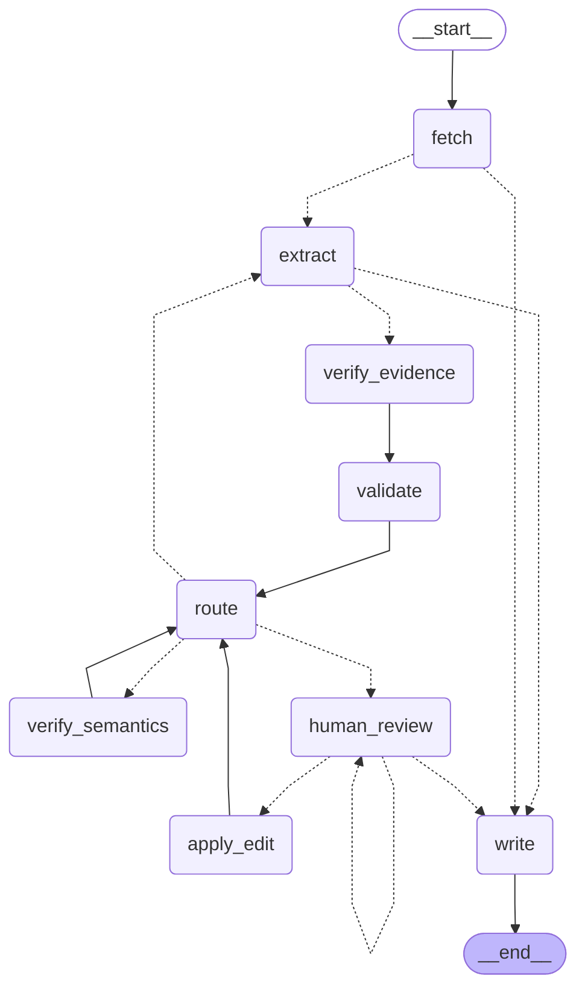

# Research agent graph

Generated from `build_graph().get_graph().draw_mermaid()` (a test checks every node name appears here).

Solid arrows are fixed edges, dotted arrows are conditional. Reading the diagram:
`fetch -> extract -> verify_evidence -> validate -> route`. When every deterministic check passes, `route` sends
the candidate to `verify_semantics` (the independent auditor), which returns to `route`. `route` then either loops
back to `extract` (deterministic errors or blocking auditor findings, both counted against the 3-attempt cap) or
continues to `human_review`. `human_review -> write -> END`.
`human_review -> apply_edit -> route` handles human edits, and `human_review -> human_review`
re-prompts after an invalid decision. `fetch` and `extract` can jump straight to `write` on a fatal
error so that a `failed` report is recorded.

## Nodes and why they exist

| Node | Kind | What it does | Why it exists |
|---|---|---|---|
| `fetch` | deterministic | Public http(s) URL only (SSRF-hardened: see below) or, only with `--file`, a local file under an allowed directory; resets every per-run state field on entry; HTML (BeautifulSoup, nav/script/footer stripped, `__NEXT_DATA__` fallback for SPA pages) or PDF (pypdf) to clean text; stores sha256 + timestamp | The LLM must see exactly the text that evidence is later checked against; the hash ties a record to a source version |
| `extract` | LLM | Prompt with allowed `Profile` fields/ops, one fictional example, document wrapped as untrusted data; on retries replays the previous answer plus the exact errors; JSON parsed and Pydantic-validated (`ExtractedScheme`); the pipeline, not the model, sets `source_url` | Produces the structured candidate. Retry-with-feedback turns most format/field mistakes into self-corrections |
| `verify_evidence` | deterministic | Every quote (name, benefits, each rule, each document, each unmapped criterion, how-to-apply) must occur in the source after normalising whitespace, case, quotes, dashes, zero-width chars and non-ASCII digits; substring matches need word/digit boundaries; tiny fuzzy tolerance (rapidfuzz partial ratio >= 95, quotes >= 20 chars) is allowed only when every NUMBER in the quote (Indian grouping, lakh/crore, number words, Devanagari/Tamil digits) equals the numbers in the matched source window; "..." fragments checked separately | The main anti-hallucination gate: a claim without a verbatim quote cannot pass |
| `validate` | deterministic | Pydantic `Scheme`; every number in a rule (also `in` lists and `any_child` sub-conditions) must appear in the rule's own evidence quote (blocking; digit boundaries, `1,00,000 = 100000 = 1 lakh`; only "below 18 -> 17"-style exclusive bounds and monthly x12 are derived); free-text URLs/phones/e-mails are flagged and off-allowlist URLs are blocking; `source_url` must be the fetched final URL or explicit; fields must exist on `Profile`/`Child`; ops valid for the field type; values typed correctly (bool/int/enum); snake_case unique id (or flagged UPDATE); http(s) `source_url`; contradictory-rule detection; then behavioural boundary tests: profiles generated from the rules (at/below threshold, flipped booleans, no children, ...) must give the verdicts the real engine `check_scheme` is expected to give | Makes "machine-checkable" literally true; catches wrong ranges, impossible rules, and engine/record disagreement |
| `verify_semantics` | LLM (second agent) | Adversarial auditor, given ONLY the cleaned source text and the candidate (no extractor reasoning, no retry history, no evidence quotes). Structured output: issues `{rule_index/field, severity blocking\|warning, problem, supporting_quote}` and `missing_criteria`. Every supporting quote is checked with the deterministic evidence matcher; findings with a quote that is not in the source are dropped. Blocking findings become `auditor: ...` errors; warnings become "Auditor notes" at review. Model: `RESEARCH_VERIFIER_MODEL` (default: the extractor's model) | The evidence check proves a quote exists, not that the rule reads it correctly ("aged 40 to 79" -> only `age gte 40`). A different role and ideally a different model cross-checks the extractor; the deterministic quote check stops the auditor's own hallucinations from blocking good candidates |
| `route` | deterministic | Records each attempt's errors; no errors and not yet audited -> `auditing` (to `verify_semantics`); no errors and audited -> `ready_for_review`; errors and attempts < 3 and not human-edited -> `retrying` (back to `extract`); otherwise `needs_human_fix` | Bounded self-correction; a human edit never triggers further LLM calls (and the auditor is not re-run on an edit; the review says so) |
| `human_review` | interrupt | `interrupt()` with a payload holding the proposed record, evidence per rule, unmapped criteria, warnings, auditor notes, contact details found in free text, errors and, for an existing id, a field-by-field diff. Resume value: `approve`, `reject` or `edit` (record). Approving a candidate with blocking errors is refused and the prompt is shown again; URL-only errors can be approved with `--allow-url URL` (recorded in provenance) | Every addition is approved by a person; the checkpointer (SQLite in the CLI) lets the review happen in a later process |
| `apply_edit` | deterministic | Re-runs schema, evidence and validation on the edited record, then goes to `route` | Edits get the same scrutiny as LLM output |
| `write` | deterministic | Approved: writes `data/candidates/<id>.json` (scheme, evidence, unmapped criteria, warnings, provenance block) and the source snapshot `data/candidates/sources/<id>.txt`. Rejected/failed: only a report | Nothing touches `data/schemes.json` until `python -m research merge` re-validates everything |

## Merge (outside the graph)

`research/merge.py` takes approved candidate files and, all-or-nothing: checks the human decision is
recorded, re-validates each record (including boundary tests), re-verifies evidence against the stored
source snapshot (hash must match), refuses to overwrite an existing id without `--allow-update`, runs
every case in `evals/eligibility_cases.json` against the merged database, writes
`data/schemes.json` atomically (temp file + fsync + `os.replace`; a timestamped `schemes.json.<UTC>.bak` is kept, never overwritten), copies it byte-identically to `web/src/data/schemes.json` when that directory exists, then moves merged candidates to `data/candidates/merged/`. It also requires the source snapshot to exist and lie inside the candidates directory (`--allow-unverified` waives a missing one), that the scheme equals what its stored evidenced candidate yields, that `source_url` is the fetched final URL or explicit, and that no unapproved off-allowlist URL is in the free text.

## Network and file safety (fetch)

`http`/`https` only; no credentials in URLs; ports 80/443; the host is resolved and every address must be a public
unicast address (loopback, private, link-local incl. 169.254.169.254, CGNAT, multicast, reserved and IPv6 equivalents,
also IPv4 wrapped in IPv4-mapped/NAT64/6to4 IPv6, are refused). Redirects are followed by hand (max 5) and every hop is
re-validated. The connection itself is pinned: a custom httpcore backend resolves, validates and connects to the
validated IP in one step (TLS still checks the certificate for the hostname), so DNS rebinding between check and connect
cannot reach an internal address. Proxy environment variables are ignored (a proxy would do the DNS lookup for us). A
wall-clock deadline (60 s) covers the whole fetch, on top of the per-operation timeout and 8 MB cap.
`RESEARCH_ALLOWED_DOMAINS=gov.in,nic.in` restricts every hop to those domains; by default any public host is allowed
but a non-government source gets a warning. Local files are read only via `--file`, only below `RESEARCH_ALLOWED_DIRS`
(default: the repo's `data/` and `tests/fixtures/`), with symlinks and `..` resolved first.
